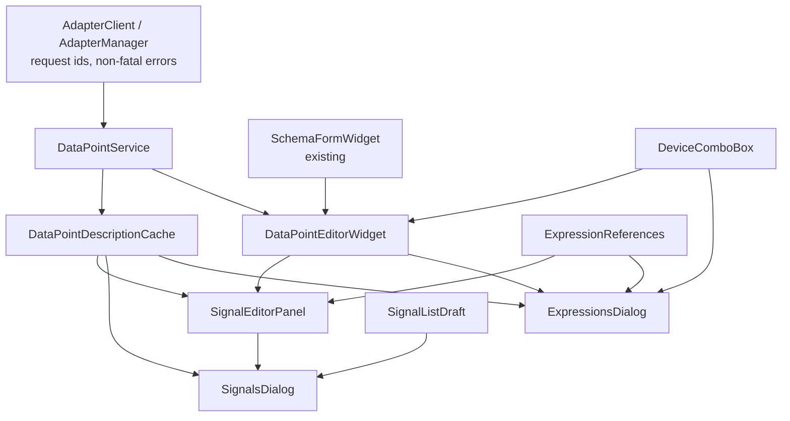
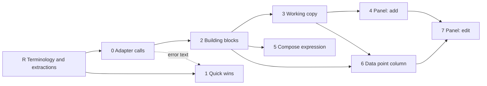

# Adding and Editing Data Points: Implementation Plan

## Summary

This plan turns the [UX review](report.md) into phases that can each be merged on their own. Every phase leaves the application working, ships with tests, and gets its own changelog entry.

The plan is shaped by three findings from reading the code in this repository and in the adapter repositories (ModbusAdapter, BacnetAdapter, IEC104Adapter, DummyAdapter):

| Finding | Consequence for the plan |
| --- | --- |
| A JSON-RPC error reply to `adapter.buildExpression` or `adapter.describeDataPoint` is handled as fatal in `AdapterClient::onErrorReceived()`: the adapter process is stopped and `sessionError` is emitted. Every adapter returns `-32602` for invalid `buildExpression` fields. | Fix this before any UI sends `buildExpression` on every field change. It is phase 0. |
| `AdapterClient` keeps one pending request per method. A second `describeDataPoint` makes the reply to the first one stale, and results are broadcast on a shared signal that callers catch with `Qt::SingleShotConnection`. | A side panel, a description column and the Compose expression dialog would interfere with each other. Requests need ids, and one service should route them. |
| All four adapters already return `describeDataPoint` `fields` with the same keys as their `addressSchema` (Modbus: `objectType`, `address`, `dataType`, `deviceId`; BACnet: `objectType`, `instance`, `deviceId`; IEC 104: `ioa`, `deviceId`; Dummy: `address`, `deviceId`). | The "contract change" in the review is only a spec change. No adapter code has to change for edit mode. |

Smaller findings that change details of the review:

- `ExpressionChecker::addresses()` cannot drive the data point list: `ExpressionParser::findOrAddDataPoint()` merges duplicates, so `${40001} - ${40001}` yields one entry. Occurrence-based editing needs a new helper.
- The spec section for `adapter.dataPointSchema` is out of date. It documents `dataTypes` and `defaultDataType`, but the adapters return `addressSchema` (with `dataType` as a property) and `defaults`, which is what `AddRegisterWidget` reads.
- `adapter.describeDataPoint` accepts a single `${...}` reference, not a full expression. The spec does not say so.
- `buildExpression` uses the adapter's own notation. Rebuilding `${40002:s16b}` gives `${h1:s16b}`. The panel must therefore only rewrite a reference after the user changes one of its fields.
- Expression validity in the table (`GraphData::ExpressionState`) is set by `ExpressionStatus`, which listens to one specific `GraphDataModel`. A working copy needs its own `ExpressionStatus`.
- The adapter lookup (device → adapter id → `AdapterManager`, with an "adapter not running" fallback) is written three times: `AddRegisterWidget::applyDevice()`, `ExpressionsDialog::managerForDescribeRow()` and `SignalsDialog::initDefaultExpressionTarget()`.

Scope: ModbusScope only. No adapter repository needs to change. Phase 0 includes a spec update that the adapter repositories should mirror when they next sync the spec.

---

## 1. Module map

The plan adds six modules and changes several more. Each new module has one job and can be tested without the dialogs. Names are the names after phase R.

| Module | Location | New / changed | Job | Phase |
| --- | --- | --- | --- | --- |
| `DeviceComboBox` | `src/customwidgets/devicecombobox.*` | New | Device selector that fills itself from `SettingsModel` and keeps its selection when the device list changes | R |
| `DataPointUsage` | `src/datahandling/datapointusage.*` | Changed | Also builds the data point limit warnings, now in `SignalsDialog` | R |
| `SettingsModel` | `src/models/settingsmodel.*` | Changed | `adapterDisplayName()`: adapter name, falling back to the id, without inserting a phantom entry | R |
| `GraphDataModel` | `src/models/graphdatamodel.*` | Changed | `removeSignals(QList<GraphIdx>)`; `clearData(GraphIdx)` (phase 3) | R, 3 |
| `AdapterClient`, `AdapterManager` | `src/ProtocolAdapter/` | Changed | Non-fatal errors for data point calls; request ids on aux requests | 0 |
| `DataPointService` | `src/ProtocolAdapter/datapointservice.*` | New | Route data point calls for a device to its adapter; match replies to requests | 0 |
| `ExpressionReferences` | `src/util/expressionreferences.*` | New | Find each `${...}` occurrence with its position; replace one occurrence | 2 |
| `DataPointDescriptionCache` | `src/models/datapointdescriptioncache.*` | New | Cache `describeDataPoint` results per reference text | 2 |
| `DataPointEditorWidget` | `src/customwidgets/datapointeditorwidget.*` | New | Device selector, address form, preview of the built reference, error text | 2 |
| `SignalListDraft` | `src/models/signallistdraft.*` | New | Working copy of the signal list; applies changes on OK | 3 |
| `SignalEditorPanel` | `src/dialogs/signaleditorpanel.*` | New | Side panel in the Signals dialog: add mode and edit mode | 4, 7 |
| `SignalsDialog` | `src/dialogs/signalsdialog.*` | Changed | Hosts the draft, the panel and the description column | 3, 4, 6 |
| `ExpressionsDialog`, `ExpressionHighlighting` | `src/dialogs/` | Changed | Layout, validation gate, Insert data point, error position | 1, 5 |
| `AddRegisterWidget` | `src/dialogs/addregisterwidget.*` | Removed in phase 4 | Its form moves into `DataPointEditorWidget` (phase 2), the rest into `SignalEditorPanel` | 2, 4 |

### Dependencies between modules



The dialogs depend on the building blocks, never the other way round. `DataPointEditorWidget` knows nothing about signals (name, axis, colour): it produces a data point reference. `SignalEditorPanel` knows about signals but not about adapter calls.

---

## 2. Phases



Phase R goes first: it renames files and classes that every later phase touches, so doing it later would conflict with all of them. Merge it quickly to keep conflicts with other branches small. Phase 1 can be done in parallel with phases 0 and 2. Only its "show why `buildExpression` failed" item waits for phase 0. Phases 5 and 6 are independent of each other and of phase 4.

| Phase | Result for the user | Size |
| --- | --- | --- |
| R | No visible change. Code uses *signal* and *data point*; six pieces of dialog logic are testable on their own | M |
| 0 | Invalid address input no longer stops the adapter | M |
| 1 | Compose expression cannot save a broken expression; editor and add form are easier to use | S |
| 2 | No visible change. The add popup now runs on the shared editor widget | M |
| 3 | Cancel discards every change made in the Signals dialog; OK clears the data of signals whose expression changed | M |
| 4 | Adding signals happens in a side panel that stays open | M |
| 5 | Data points can be inserted in Compose expression without typing syntax | M |
| 6 | The Signals table shows what each data point is | S |
| 7 | Existing data points are edited through the same form | L |

---

### Phase R: Terminology and extractions

**Goal:** the code uses the same words as the UI and the manual, and the logic the later phases change is out of the dialogs and covered by tests. No behaviour changes.

The terms:

| Term | Meaning | Replaces |
| --- | --- | --- |
| Signal | One row in the Signals dialog and one graph: name, colour, axis, expression | "register" for a row (`RegisterDialog`, `addRegister()`, `registerView`) |
| Data point | One `${...}` reference that an adapter reads | "register" for a polled value (`_registerList`, `registerDataReady`, `cMatchRegister`) |
| Register | Only for Modbus registers: MBC files and Modbus-specific settings | — |

#### R.1 Renames

Mechanical renames, one commit per group. Each commit builds and passes the tests unchanged apart from the renamed names.

##### Signals dialog

| Old | New |
| --- | --- |
| `RegisterDialog`, `registerdialog.{h,cpp,ui}` | `SignalsDialog`, `signalsdialog.{h,cpp,ui}` |
| `tests/dialogs/tst_registerdialog.*`, `TestRegisterDialog` | `tst_signalsdialog.*`, `TestSignalsDialog` |
| `registerView` (ui object) | `signalView` |
| `RegisterValueAxisDelegate`, `registervalueaxisdelegate.*` | `ValueAxisDelegate`, `valueaxisdelegate.*` |
| `addRegister()`, `addDefaultRegister()`, `removeRegisterRow()`, `onRegisterInserted()` | `addSignal()`, `addDefaultSignal()`, `removeSelectedSignals()`, `onSignalInserted()` |
| `_registerPopupAction`, `registerPopupMenu` | `_addSignalAction`, `pAddSignalWidget` |
| `MainWindow::showRegisterDialog()`, `handleShowRegisterDialog()`, `actionRegisterSettings` | `showSignalsDialog()`, `handleShowSignalsDialog()`, `actionSignals` |
| `GuiStateController` action `pRegisterSettings` | `pSignals` |

`AddRegisterWidget` keeps its name: phase 2 shrinks it and phase 4 deletes it.

##### Data points in the polling and expression pipeline

| Old | New |
| --- | --- |
| `AdapterClient`/`AdapterManager::startSession(registerExpressions)`, `provideConfig(..., registerExpressions)` | `dataPointExpressions` |
| `AdapterPoll::_registerList`, `triggerRegisterRead()`, `registerDataReady()`; log texts "Active registers", "registers — skipping group" | `_dataPoints`, `triggerDataPointRead()`, `dataPointValuesReady()`; "Active data points", "data points — skipping group" |
| `ScopeController` `registerList` locals | `dataPoints` |
| `GraphDataHandler::handleRegisterData()`, `setupExpressions(..., registerList)` | `handleDataPointValues()`, `setupExpressions(..., dataPoints)` |
| `QMuParser::setRegistersData()`, `_registerValues`, `registerValue` | `setDataPointValues()`, `_dataPointValues`, `dataPointValue` |
| `mu::ParserRegister`, `muparserregister.*`, `registerCb_t`, `setRegisterCallback()`; error "invalid index in register list" | `mu::ParserDataPoint`, `muparserdatapoint.*`, `dataPointCb_t`, `setDataPointCallback()`; "invalid index in data point list" |
| `ExpressionParser::processRegisterExpression()`, `constructInternalRegisterFunction()`, `_cRegisterFunctionTemplate` | `processDataPointReference()`, `constructInternalDataPointFunction()`, `_cDataPointFunctionTemplate` |
| `ExpressionRegex::cMatchRegister`, `cParseReg` | `cMatchDataPoint`, `cParseDataPoint` |
| `ExpressionHighlighting::configureRegisterRules()`, `handleRegisterRules()`, `_registerExpression`, `_validRegisterExpression`, `_validRegFormat` | `configureDataPointRules()`, `handleDataPointRules()`, `_dataPointExpression`, `_validDataPointExpression`, `_validDataPointFormat` |
| `AdapterData::maxRegisters()` | `maxDataPoints()` (still reads the `maxRegisters` capability key) |
| `ProjectFileData::RegisterSettings`, `registerList` | `SignalSettings`, `signalList` |
| `DataFileExporter::registerProperty` | `signalProperty` |

**Kept as "register"**, because the word is correct there or is part of a stored or wire format:

- `src/MbcInterface/`, `ImportMbcDialog` and its texts: MBC files describe Modbus registers.
- Project file tag `ProjectFileDefinitions::cRegisterTag` (`"register"`), JSON keys, and the legacy XML parser functions named after the tags (`parseRegisterTag()`). Old project files must keep loading.
- The `maxRegisters` capability key in the adapter protocol. Renaming it needs a protocol version change in every adapter.
- "Consecutive register maximum" in the legacy XML parser: a Modbus setting.
- Released `CHANGELOG.md` entries.

Docs: go through the "register" occurrences in `docs/manual/` (about 30, mostly in polling and connection pages). Change the ones that mean a signal or data point; keep the Modbus-specific ones.

Check after the renames: `grep -rniw "register\w*" src tests` should only hit the kept list above.

#### R.2 Extractions

Logic that sits in dialogs today, moved to where it can be tested without a widget. Each extraction keeps behaviour as is and adds its tests in the same commit.

| # | From | To | Why now |
| --- | --- | --- | --- |
| E1 | `SignalsDialog::dataPointLimitWarningMessage()` | `DataPointUsage::limitWarnings(const QList<DataPoint>&, SettingsModel*)` returning one line per adapter over its limit; the dialog adds the license hint and joins | Phase 3 points the warning at the draft model; with the logic in `DataPointUsage` that is a one-argument change. Tests in `tst_datapointusage`: under, at and over the limit, unknown adapter, adapter without a name |
| E2 | `SignalsDialog::removeSelectedSignals()`, `selectedRowAfterDelete()`, `sortRegistersLastFirst()` | `GraphDataModel::removeSignals(QList<GraphIdx>)` (removes highest first) and a free function `rowAfterRemoval(firstRemovedRow, rowCount)` | The draft in phase 3 and the panel in phase 4 also remove rows. Tests in `tst_graphdatamodel` for unsorted and duplicate indices |
| E3 | "Adapter name, else the id" in `AddRegisterWidget::applyDevice()`, `ExpressionsDialog::populateHelpDevices()` and the limit warning | `SettingsModel::adapterDisplayName(const QString& adapterId)`, which checks `adapterIds()` first so it never inserts a phantom `AdapterData` | Three copies; the one in `ExpressionsDialog` calls `adapterData()` unguarded and can insert a phantom entry. Test in `tst_settingsmodel` |
| E4 | `AddRegisterWidget::populateDeviceCombo()`, `refreshDeviceCombo()`, `selectedDeviceId()` and the device part of `ExpressionsDialog::populateHelpDevices()` | `DeviceComboBox` in `src/customwidgets/`: fills from `SettingsModel::deviceList()`, follows `deviceListChanged` keeping the selection with signals blocked, emits `deviceChanged(deviceId_t)`. Label style: name only, or name with protocol and id | `DataPointEditorWidget` (phase 2) and the per-reference device selector (phase 7) need it. The help selector switches from storing an adapter id to a device id and looks the adapter up. Tests in `tests/customwidgets/tst_devicecombobox.cpp` |
| E5 | Number parsing in `ExpressionsDialog::handleInputChange()` (`QString::toDouble`) | `ExpressionValue::parse(const QString&, bool* ok)` in `src/util/` | Phase 1 adds hex and binary input; that becomes a change to one tested function |
| E6 | `ExpressionHighlighting::handleErrorPosition()` position correction | A free function returning the start and length to mark, given the parser error position and the text | Pins today's `-2` behaviour in tests, so phase 5 changes it knowingly. Tests in `tests/dialogs/tst_expressionhighlighting.cpp` |

The other duplicated code is handled where it is replaced anyway: the device-to-adapter lookup and `buildSchema()` go into `DataPointService` (0.3), the describe chain in `ExpressionsDialog` into `DataPointDescriptionCache` (2.2), and the address form into `DataPointEditorWidget` (2.3).

**Done when:** the grep check above only shows the kept list, E1 to E6 have tests, and the application behaves as before.

---

### Phase 0: Reliable adapter calls for data points

**Goal:** the UI can send `buildExpression` and `describeDataPoint` as often as it likes, from several places at once, without risk to the running adapter session.

#### 0.1 Non-fatal errors for data point calls (bug fix)

Today an invalid `buildExpression` call (for example an address the schema did not catch) stops the adapter process. The same applies to `describeDataPoint` and `dataPointSchema`.

- Add a failing test first in `tests/ProtocolAdapter/tst_adapterclient.cpp`, next to `auxRequestErrorsAreNonFatalInDegradedSession`: inject a `-32602` error for `adapter.buildExpression` and for `adapter.describeDataPoint` in `AWAITING_CONFIG` and `ACTIVE`, and assert that `sessionError` is not emitted and the client stays usable.
- In `AdapterClient::onErrorReceived()`, handle both methods like `adapter.validateDataPoint`: consume the pending id and emit a result.
  - `describeDataPoint`: emit `describeDataPointResult` with `{ "valid": false, "error": <message> }`, the same shape as an invalid parse.
  - `buildExpression`: add a signal `buildExpressionFailed(QString error)` on `AdapterClient` and `AdapterManager`. Keep `buildExpressionResult` for success only, so an empty string never has to mean "failed".
- `dataPointSchema` errors: log and keep the session. The address form then shows no fields, as it does today for an adapter that is not running.

#### 0.2 Request ids for aux requests

- `AdapterClient::_pendingAuxRequests` changes from one id per method to a set of pending ids, each mapped to its method.
- `describeDataPoint()` and `buildExpression()` return the JSON-RPC request id (`int`, `-1` when not sent). `AdapterManager` passes it through.
- The result signals gain the id as first argument: `describeDataPointResult(int requestId, QJsonObject result)`, `buildExpressionResult(int requestId, QString expression)`, `buildExpressionFailed(int requestId, QString error)`.
- `expressionHelp` and `dataPointSchema` keep "latest request wins". Nothing sends them concurrently.
- Update the re-emitting signals in `AdapterHub` (lines 213-215), or drop them: nothing in `src/` or `tests/` connects to them.
- Existing callers keep working by ignoring the id until they move to `DataPointService` in 0.3.

#### 0.3 `DataPointService`

One object per dialog that owns the "which adapter answers for this device" logic.

```cpp
class DataPointService : public QObject
{
    Q_OBJECT
public:
    DataPointService(SettingsModel* pSettingsModel, AdapterHub* pAdapterHub, QObject* parent = nullptr);

    bool isDeviceUsable(deviceId_t deviceId) const;
    QString adapterIdForDevice(deviceId_t deviceId) const;
    QJsonObject addressSchema(deviceId_t deviceId) const; // deviceId property removed
    QJsonObject defaults(deviceId_t deviceId) const;

    quint64 buildExpression(deviceId_t deviceId, const QJsonObject& fields);   // dataType taken from fields
    quint64 describeDataPoint(deviceId_t deviceId, const QString& reference);

signals:
    void expressionBuilt(quint64 ticket, QString expression);
    void expressionFailed(quint64 ticket, QString error);
    void dataPointDescribed(quint64 ticket, QJsonObject result);
};
```

- Tickets are the service's own counter, so callers never deal with per-adapter request ids. When the adapter is not usable, the service returns a ticket and emits the failure on the next event loop turn, so callers have one code path.
- `addressSchema()` absorbs `AddRegisterWidget::buildSchema()` (stripping the adapter's own `deviceId` property).
- Move the three existing callers to the service: `AddRegisterWidget::handleResultAccept()`, `ExpressionsDialog::startNextDescribe()` and `SignalsDialog::requestDefaultExpression()`. This removes the duplicated lookups and the `Qt::SingleShotConnection` plumbing.
- Tests: `tests/ProtocolAdapter/tst_datapointservice.cpp` with the existing `MockAdapterHub` and a mock `AdapterManager`. Cover routing per device, unknown device, adapter not running, two interleaved requests answered in reverse order.

#### 0.4 Spec update

In `docs/technical/adapter-protocol-spec.md`:

- `adapter.dataPointSchema`: document the result the adapters actually return: `addressSchema` (with `dataType` as a property where the protocol has types) and `defaults`.
- `adapter.describeDataPoint`: the parameter is one `${...}` reference. When valid, `fields` uses the same keys as `addressSchema`, plus `deviceId`, so that passing `fields` back to `buildExpression` reproduces the same data point. This replaces "the core treats them as opaque display data". All four adapters already do this.
- `adapter.buildExpression`: state that a `-32602` error is an expected, non-fatal reply.

**Done when:** an invalid `buildExpression` call from the add form leaves the adapter running and shows nothing worse than today; the three callers use `DataPointService`; all existing tests pass.

---

### Phase 1: Quick wins

Small, independent changes from section 6, step 1 of the review. Each can be its own commit with a test in `tst_expressionsdialog` or `tst_addregisterwidget`.

| Change | Where | Test |
| --- | --- | --- |
| Disable Accept while `handleResultReady(valid)` is false or a device is unknown | `ExpressionsDialog` | Set an invalid expression, assert the Accept button is disabled and `handleAccept()` leaves the model unchanged |
| Wrap the editor, show a vertical scroll bar when needed, Enter accepts, Shift+Enter is ignored | `expressionsdialog.ui`, key filter in `ExpressionsDialog` | Send Enter with a valid expression, assert accepted |
| Standard `QDialogButtonBox` with Cancel/Accept and a compact default size; complete tab order | `expressionsdialog.ui` | Existing tests still find the buttons |
| Example input accepts `0x` and `0b` values; default example input is `1` instead of `0` | `ExpressionValue::parse()` (E5), `ExpressionsDialog` | `100 / ${40001}` opens without an error; `0x10` evaluates as 16 |
| Name field uses placeholder text; empty name falls back to `GraphDataModel::uniqueLabel()` | `AddRegisterWidget` | Add with empty name gives "New signal", "New signal 2" |
| Show the reason when `buildExpression` fails (needs 0.1) | `AddRegisterWidget` | Mock manager emits failure, assert the label shows the message and the popup stays open |
| Manual: document the add form, remove the "turns green" claim | `docs/manual/how-to/add-data-points.md`, `write-expressions.md` | — |

`uniqueLabel()` is private today. Make it public, or add `GraphDataModel::add(GraphData)` behaviour that fills an empty label. The second keeps the rule in the model, which is preferred.

---

### Phase 2: Shared building blocks

**Goal:** the three new modules exist and are tested, and the add popup already uses the editor widget. Nothing visible changes.

#### 2.1 `ExpressionReferences`

A small set of pure functions over expression text. It replaces nothing; `ExpressionChecker` keeps evaluating expressions.

```cpp
namespace ExpressionReferences {

struct Reference
{
    qsizetype start;
    qsizetype length;
    QString text;         // "${40003:s16b}"
    deviceId_t deviceId;  // from the @n part, Device::cFirstDeviceId when absent
};

QList<Reference> find(const QString& expression);   // every occurrence, in order, duplicates included
QString replace(const QString& expression, const Reference& reference, const QString& newText);

} // namespace ExpressionReferences
```

- Built on `ExpressionRegex::cMatchDataPoint` and `cParseDataPoint`, the same regexes the parser uses, so the two cannot disagree on what a reference is.
- `replace()` checks that `expression.mid(start, length) == text` before replacing and returns the input unchanged otherwise. This guards against a stale reference after the expression changed underneath.
- Tests in `tests/util/tst_expressionreferences.cpp`: no references, one, duplicates, references with whitespace (`${ 40001 @ 2 : s16b }`), invalid content inside `${}`, replacing the second of two identical references, stale reference.

#### 2.2 `DataPointDescriptionCache`

Turns the sequential describe chain in `ExpressionsDialog` into a shared lookup.

```cpp
struct DataPointDescription
{
    enum class State { Pending, Valid, Invalid, Unavailable };
    State state;
    QString description;
    QJsonObject fields;
    QString error;
};

class DataPointDescriptionCache : public QObject
{
    Q_OBJECT
public:
    explicit DataPointDescriptionCache(DataPointService* pService, QObject* parent = nullptr);

    DataPointDescription lookup(const ExpressionReferences::Reference& reference); // requests on a miss

signals:
    void descriptionChanged(const QString& referenceText);
};
```

- Keyed by reference text. The device is part of the text, so one key always maps to one adapter.
- One request per key at a time; repeated lookups while pending do not send again.
- `Unavailable` when the device is unknown or its adapter is not running. Callers fall back to the raw reference.
- Owned by `SignalsDialog` and shared with the panel and with `ExpressionsDialog` (passed in), so a description fetched for the table is reused in the dialog.
- Tests in `tests/models/tst_datapointdescriptioncache.cpp` with a mock service.

#### 2.3 `DataPointEditorWidget`

Extract the address part of `AddRegisterWidget` into a reusable widget.

Moves out of `AddRegisterWidget`: the `DeviceComboBox` (extracted in E4), `applyDevice()`, `rebuildAddressForm()`, the `SchemaFormWidget`, the protocol label. Stays behind: name, axis, Add button, the menu workarounds.

```cpp
class DataPointEditorWidget : public QWidget
{
    Q_OBJECT
public:
    DataPointEditorWidget(SettingsModel* pSettingsModel, DataPointService* pService, QWidget* parent = nullptr);

    void setDevice(deviceId_t deviceId);              // resets the form to the adapter defaults
    void setFields(const QJsonObject& fields);        // fields from describeDataPoint; selects fields["deviceId"]
    deviceId_t deviceId() const;
    QString expression() const;                       // last reference built for the current values
    bool hasValidExpression() const;

signals:
    void expressionChanged(const QString& expression);
    void errorChanged(const QString& error);          // empty when there is no error
};
```

- On `SchemaFormWidget::valuesChanged`, the widget asks the service to build the reference and shows it as a preview. Replies with an old ticket are ignored, so fast typing cannot show a stale preview.
- `setFields()` fills the form without triggering a build. The preview shows the original reference text until the user changes a field. This is what preserves the user's notation (`${40002}` is not silently rewritten to `${h1}`).
- Keys in `fields` that the device's schema does not know are ignored; missing keys take the schema default.
- `AddRegisterWidget` embeds the new widget and uses `expression()` on Add, instead of sending its own `buildExpression`. `tst_addregisterwidget` should pass with only setup changes.
- New tests in `tests/customwidgets/tst_datapointeditorwidget.cpp`: device switch rebuilds the form, `setFields()` round trip, stale reply ignored, adapter not running, build failure shows the error.

**Done when:** the three modules have tests, the add popup works as before on top of `DataPointEditorWidget`, and `ExpressionsDialog` uses the cache instead of `startNextDescribe()`.

---

### Phase 3: Working copy and Cancel

**Goal:** the Signals dialog edits a copy. OK applies, Cancel and Esc discard. Remove needs no confirmation.

#### 3.1 `SignalListDraft`

```cpp
class SignalListDraft : public QObject
{
    Q_OBJECT
public:
    SignalListDraft(GraphDataModel* pSource, SettingsModel* pSettingsModel, QObject* parent = nullptr);

    GraphDataModel* model();   // what the dialog's table, panel and limit warning use
    bool hasChanges() const;
    void apply();              // write the draft back to the source model
};
```

- `model()` is a second `GraphDataModel` filled from the source on construction (label, colour, active, visible, axis, expression). It gets its own `ExpressionStatus`, so invalid rows are still marked red.
- The default expression (`setDefaultExpression`) is set on the draft model.
- `DataPointUsage::limitWarnings()` (E1) gets the draft's data points, so the warning reflects what OK would apply.
- `apply()` must keep the data of rows that still exist with the same expression. Removing and re-adding everything would empty the graph after a stopped log when the user only renamed a signal. A row whose expression changed loses its samples: they were computed from the old expression and no longer match it. Approach:
  1. Track each draft row's origin (source row, or new). Before coding, check whether `GraphDataStore` keeps the `QSharedPointer<GraphDataSeries>` when a `GraphData` is added. If it does, the series pointer identifies a row with no extra field. If not, add a non-persisted row id to `GraphDataStore`.
  2. Remove source rows that are gone (highest first), update changed properties of kept rows with the existing setters, add new rows, then move rows into draft order.
  3. For every kept row whose expression changed, clear its data series. `GraphDataSeries::clear()` exists, but there is no model-level call for one row: add `GraphDataModel::clearData(GraphIdx)` (through `GraphDataStore`) and make sure the graph view repaints that graph. Check which signal the graph view listens to for data updates before choosing the signal to emit.
  4. `hasChanges() == false` means `apply()` does nothing and no signals are emitted.
- Tests in `tests/models/tst_signallistdraft.cpp`: no change, rename only (data series kept), expression change (data series cleared, other rows keep theirs), add, remove, reorder, combinations, expression change updates `ExpressionStatus`. Add a test for `GraphDataModel::clearData()` in `tests/models/`.

#### 3.2 `SignalsDialog`

- Construct the draft and point the table, the delegates and the limit warning at `draft.model()`.
- Replace the OK-only box with OK/Cancel. OK calls `apply()`; Cancel and Esc do not.
- `ExpressionsDialog` receives the draft model, so its Accept writes to the draft as well.
- Update `tst_signalsdialog`: Cancel after add/remove leaves the source model unchanged; OK applies.

**Done when:** every change in the dialog, including from Compose expression, can be undone with Cancel, and pressing OK without changes leaves the graph untouched.

---

### Phase 4: Side panel in add mode

**Goal:** mockup 2 of the review. The popup and its `QMenu` workarounds are removed.

- New `SignalEditorPanel` (`.h/.cpp/.ui`) on the right of the table in `signalsdialog.ui`. It contains: name (placeholder text), axis radios, `DataPointEditorWidget`, an **Add signal** button and a status line.
- **Add** enters add mode instead of inserting a placeholder row. **Add signal** appends to the draft through `GraphDataModel::add(GraphData)`, selects the new row in the table, clears only the name and keeps device, address fields, data type and axis.
- The status line shows "Added \"…\"" or the build error from `DataPointEditorWidget::errorChanged`.
- Remove `AddRegisterWidget`, `_addSignalAction`, `addDefaultSignal()`, `resizeContainingMenu()` and `closeContainingMenu()`. Move the relevant cases from `tst_addregisterwidget` to `tests/dialogs/tst_signaleditorpanel.cpp`.
- The default-expression logic in `SignalsDialog` (`requestDefaultExpression()`) becomes unused once Add no longer inserts a placeholder. Remove it, unless another caller of `GraphDataModel::add()` without arguments still needs a sensible default; check `ImportMbcDialog` and project loading first.
- Panel layout: give the table a stretch factor and the panel a fixed preferred width; at narrow widths the panel goes below the table (`QSplitter` with vertical fallback is enough).
- Update the manual page for adding data points and its screenshot.

**Done when:** ten signals with consecutive addresses can be added without reopening anything, and the popup code is gone.

---

### Phase 5: Compose expression

**Goal:** mockup 4 of the review.

- **Insert data point…** toggles an inline `DataPointEditorWidget` with an **Insert at cursor** button. Insert puts `expression()` at the text cursor of the editor.
- The data point table uses `DataPointDescriptionCache` (already done in phase 2) and `ExpressionReferences::find()` for its rows, so duplicates get one row each, in expression order. Example values stay keyed by reference text, so duplicate references share a value, as the evaluation does.
- Error position: today the mark runs from the error to the end of the line, with a `-2` correction. Change the function extracted in E6 to mark the offending token (the reference or number at the position, else one character), and update its tests from phase R accordingly.
- Show per-reference adapter errors (`Invalid` from the cache) as a tooltip and red text on the row in the data point table, and keep Accept disabled while any row is `Invalid`.

**Done when:** a second data point can be added to an expression without typing `${…}`, and the error mark points at the problem.

---

### Phase 6: Data point column

**Goal:** the table shows the adapter's description of each signal's data points.

- Add the column in a proxy model in the dialog layer, not in `GraphDataModel`. The description depends on running adapters and only matters in this dialog; `GraphDataModel` is also used for export and the graph.
- `SignalTableProxyModel` (`src/dialogs/signaltableproxymodel.*`), a `QIdentityProxyModel` subclass that maps one extra column. If an extra column on an identity proxy proves awkward, override `data()` for the existing Expression column's tooltip and add the column through a small `QAbstractProxyModel` instead.
- Text per row: the description for one reference, "2 data points" plus a tooltip with each description for more, the parser error for an invalid expression. While pending or unavailable, the raw reference.
- Listens to `DataPointDescriptionCache::descriptionChanged` and emits `dataChanged` for the affected rows only.
- The invalid-row tooltip shows the specific error from the cache instead of the two generic texts.
- Drag-and-drop reordering goes through the proxy; check that `InternalMove` still works and cover it in `tst_signalsdialog`.

**Done when:** opening the dialog shows a readable description for every valid row within a moment, without blocking the dialog.

---

### Phase 7: Side panel in edit mode

**Goal:** mockups 1, 3a and 3b of the review.

- Selecting one row puts `SignalEditorPanel` in edit mode for that row. Name and axis edit the row directly.
- `ExpressionReferences::find()` on the row's expression:
  - **One reference:** the editor shows it; the expression preview marks the reference (mockup 3a).
  - **More than one:** a list of references with descriptions from the cache; selecting one loads it into the editor (mockup 3b).
  - **Expression does not parse:** the parser error and **Edit expression…** only.
- Loading a reference: `cache.lookup(ref)` → `editor.setFields(description.fields)`. While pending, the editor is disabled with the raw reference shown.
- When the editor emits `expressionChanged` after a user edit, the panel calls `ExpressionReferences::replace()` on the row's current expression and writes the result to the draft. The rest of the expression is kept as typed.
- After the write, the panel re-runs `find()` and keeps the same occurrence index selected, so the user can keep editing.
- **Edit expression…** opens Compose expression for the row and refreshes the panel when it closes.
- Device per reference: the editor's device selector. Changing it to a device on another adapter resets the form to that adapter's defaults (see decisions below).
- Tests in `tst_signaleditorpanel`: edit the address of a single reference, edit the second of two identical references, arithmetic around the reference is kept, invalid expression shows only the error, cancel of the dialog discards panel edits.

**Done when:** a signal's address, type and device can be changed without touching the syntax, and arithmetic in the expression survives.

---

## 3. Testing approach

| Layer | Test style | Files |
| --- | --- | --- |
| `AdapterClient`, `DataPointService` | Qt Test with `MockAdapterProcess`, `MockAdapterHub`, mock `AdapterManager` | `tests/ProtocolAdapter/` |
| `ExpressionReferences` | Google Test or Qt Test, pure functions | `tests/util/` |
| `DataPointDescriptionCache`, `SignalListDraft` | Qt Test with a mock service; `QSignalSpy` on model signals | `tests/models/` |
| `DataPointEditorWidget` | Qt Test, widget driven through its child widgets | `tests/customwidgets/` |
| Panel and dialogs | Qt Test, as `tst_signalsdialog` and `tst_expressionsdialog` today | `tests/dialogs/` |

The adapter mocks answer `buildExpression` and `describeDataPoint` with canned replies. One integration test in `tests/integration/` should run the real Dummy adapter through `describeDataPoint` → `buildExpression` and check that the round trip gives back the same reference. That pins down the `fields` contract from 0.4.

## 4. Decisions

### Decided

| Question | Decision |
| --- | --- |
| Duplicates such as `${40001} - ${40001}` | One entry per occurrence; each is edited on its own |
| Device per signal or per data point | Per data point; the address form follows that device's adapter |
| On OK, does a row whose expression changed keep its samples from a stopped log? | No. Its data is cleared; rows with an unchanged expression keep theirs (phase 3.1). The dialog cannot be opened while logging, so this only concerns data from a stopped log |

### Recommended, to confirm

| Question | Recommendation | Why |
| --- | --- | --- |
| Are `describeDataPoint` `fields` keyed like `addressSchema`? | Yes, make it normative in the spec (0.4) | All four adapters already do it; no adapter change needed |
| Panel edits: immediately or with an Apply button? | Immediately, into the draft | Cancel on the dialog already undoes them; an extra Apply adds a second level of "unsaved" |
| Data point moved to a device on another adapter | Reset to the new adapter's defaults | Field names overlap by accident (`objectType` means different things in Modbus and BACnet); keeping values would build wrong references |
| Expression does not parse | Show the parser error and Edit expression only | Keeping an old list read-only adds state that can disagree with the text |
| Notation after an edit (`${40002}` becomes `${h1}`) | Accept it, but only for references the user changed | Keeping the notation would need a new `buildExpression` parameter in every adapter |
| Default expression for Add | Remove once Add no longer inserts a placeholder row | The panel always starts from the adapter defaults |

## 5. Kept out

As in the review: scale and offset fields, quick templates, last read value, adding a range of addresses in one step, and a batch `describeDataPoints` call. The cache in phase 2 makes a batch call easy to add later if the number of round trips becomes a problem.
