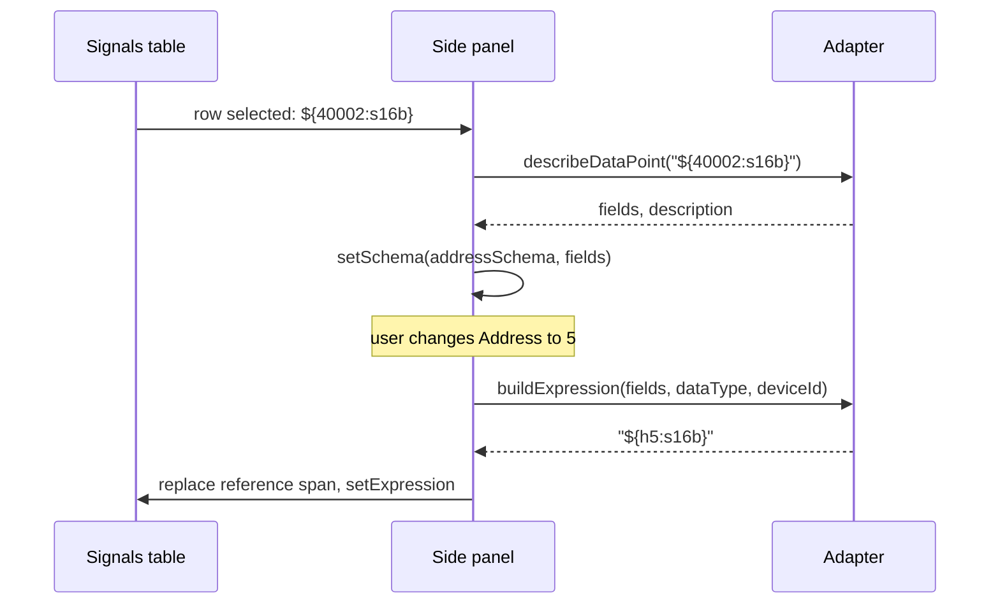

# Adding and Editing Data Points: UX Review

## Summary

A review of the Signals dialog (`RegisterDialog`), its Add popup (`AddRegisterWidget`) and the Compose expression dialog (`ExpressionsDialog`). It lists the pain points found in the code and the manual screenshots, and proposes a direction that keeps today's feature set. The rendered version with visual mockups is [signals-ux-review.html](signals-ux-review.html).

Three things hold the workflow back:

| Problem | Detail |
| --- | --- |
| Syntax is the main interface | After a signal exists, the only way to change its address, type or device is to edit `${40001@2:s16b}` by hand. The structured form is only used once, at creation. |
| No safety net | Every change hits the model immediately. There is no Cancel, no undo, no delete confirmation, and the expression dialog accepts invalid input. |
| The add form is easy to miss | The structured form hides behind a split-button arrow and closes after every add, so setting up 10+ signals is slow and repetitive. |

The adapter protocol already has `dataPointSchema`, `buildExpression`, `describeDataPoint` (which returns parsed `fields`) and `expressionHelp`. Most improvements below reuse these calls and `SchemaFormWidget`.

Scope: `src/dialogs/registerdialog.*`, `addregisterwidget.*`, `expressionsdialog.*`, `expressionhighlighting.cpp`, `src/models/graphdatamodel.cpp`, the adapter protocol spec and the manual screenshots. Analysis only, not tested against a running build.

---

## 1. Pain points: Signals dialog

### 1.1 Existing data points can only be edited as raw syntax (High)

The Add popup offers object type, address and data type fields, but once the signal exists the Expression cell is a plain text editor or the `…` button. Changing *holding register 5, s16b* to *input register 5* requires knowing the prefix and Modicon rules. The two paths teach different mental models: a form on the way in, a mini-language afterwards.

Ref: `addregisterwidget.cpp` (form only on add), `registerdialog.cpp:72` (inline EditRole on EXPRESSION).

### 1.2 No Cancel and no undo (High)

The dialog has only an OK button and writes straight to `GraphDataModel`. Delete removes rows with no confirmation and no way back, including via the Del shortcut on the table.

Ref: `registerdialog.ui:89`, `registerdialog.cpp:160`.

### 1.3 The structured add form is hidden behind a split-button arrow (High)

Clicking **Add** inserts "New signal" with a default expression. The form appears only via the small arrow next to it. The user manual describes only the first path and tells users to type `${40001}` in the cell.

Ref: `registerdialog.cpp:94`, `docs/manual/how-to/add-data-points.md`.

### 1.4 The add popup behaves like a menu, not a form (Medium)

- It closes after every add, so 10 consecutive registers means 10 open/fill/close cycles.
- A click outside closes it and throws away what was typed.
- The name resets to the literal text "Name of signal", not a placeholder, so it is easily added as the real label.
- No preview of the resulting expression before adding.
- If `buildExpression` returns empty, nothing happens and no reason is shown.
- Relayout needs a synthetic resize-event workaround because QMenu caches layout.

Ref: `addregisterwidget.cpp:209` (resizeContainingMenu), `:301` (silent empty result), `:316` (resetFields).

### 1.5 The table shows syntax, not meaning (Medium)

The Expression column shows `${40003:s16b}*10`. There is no human description ("holding register 2, signed 16-bit, device id 1"), no device name, and no last read value, although `describeDataPoint` and the graph data series exist. Invalid rows only get a light red background and one of two generic tooltips.

Ref: `graphdatamodel.cpp:87-110`.

---

## 2. Pain points: Compose expression dialog

### 2.1 Accept works on an invalid expression (High)

`handleAccept()` stores whatever is in the editor. The user sees a red error label but can still apply a broken expression, which then shows up as a red row in the table.

Ref: `expressionsdialog.cpp:166`.

### 2.2 No way to insert a data point without typing syntax (High)

The dialog has no picker. To reference a second register the user must read the help panel and type `${...}` by hand, even though the same form and `buildExpression` call already exist in the Add popup.

### 2.3 The editor hides long expressions (Medium)

The editor is a multi-line `QPlainTextEdit` with `NoWrap` and both scroll bars off. Text past the right edge is invisible. Enter inserts a newline instead of accepting, for what is a one-line expression.

Ref: `expressionsdialog.ui:76-96`.

### 2.4 Feedback is coarse (Medium)

- On a syntax error everything from the error position to the end of the line turns red, with a `-2` offset heuristic.
- Validation is regex-level; adapter-level errors (address out of range, unknown type) from `describeDataPoint` are not shown per reference.
- Test values default to `0`, so `100 / ${40001}` opens with an error.
- Test values only accept decimals; `0x10` is rejected though the expression itself supports hex.
- The manual says "the expression field turns green when the syntax is valid"; the code only colours register references.

Ref: `expressionhighlighting.cpp:104-127`, `expressionsdialog.cpp:112, 145`.

### 2.5 Layout spends space in the wrong places (Medium)

The default size is 823×854 px. The editor takes a large block for one line, the help panel is collapsed below, and Accept/Cancel sit in a side column instead of a standard button box. Only the three buttons are in the tab order.

---

## 3. Proposed direction: one form for adding and editing

The mockups keep today's feature set: the same columns, the same address fields, the same adapter calls. What changes is where things live and when they are available.

| Principle | Detail |
| --- | --- |
| Same form, both ways | The Add popup moves into a side panel bound to the selected row. Adding and editing use the same `SchemaFormWidget`. |
| Syntax stays available | The expression column and the Compose expression dialog remain for anything beyond a plain data point. The panel never rewrites the parts of an expression it does not own. |
| Changes can be undone | The dialog edits a working copy. OK applies, Cancel discards. |

### Mockup 1: editing a selected signal

```text
┌ Signals ────────────────────────────────────────────────────────────────────────────┐
│ [Add] [Remove]                                          │ Edit signal               │
│ Color Active Name          Data point                   │ Device      [Device 1   ▾]│
│ ███   ☑      Data point    holding register, 0, ...     │             Protocol: modbusAdapter
│ ███   ☑      Data point 2  holding register, 1, s16 ... │ Name        [Data point 2]│  ◄ selected
│ ███   ☐      Data point 3  holding register, 2, s16 ... │ Object type [Holding Reg ▾]│
│        (Expression and Y-Axis columns as today)         │ Address     [1          ]│
│                                                         │ Data type   [signed 16-bit▾]
│                                                         │ Axis        (•) Y1  ( ) Y2│
│                                                         │ ${40002:s16b}             │
│                                                         │ [Edit expression…]        │
├─────────────────────────────────────────────────────────┴───────────────────────────┤
│                                                                     [Cancel] [OK]   │
└─────────────────────────────────────────────────────────────────────────────────────┘
```

Selecting a row fills the panel. Field edits apply to the row through `buildExpression`; the preview shows the resulting reference. The Data point column shows the adapter's description, which the Compose expression dialog already requests today.

### Mockup 2: adding signals

```text
│ Data point 3  holding register, 2, s16, device id 1  (just added) │ New signal
│                                                                   │ Device      [Device 1      ▾]
│                                                                   │ Name        [New signal    ]  (placeholder)
│                                                                   │ Object type [Holding Reg   ▾]
│                                                                   │ Address     [3             ]
│                                                                   │ Data type   [signed 16-bit ▾]
│                                                                   │ Axis        (•) Y1  ( ) Y2
│                                                                   │ ${h3:s16b}
│                                                                   │ [Add signal]  Added "Data point 3"
```

**Add** puts the panel in add mode instead of inserting a placeholder row. After **Add signal** the panel stays open and keeps device, object type, data type and axis, so the next signal only needs a new address and name. An empty name falls back to `uniqueLabel()`. A failed `buildExpression` shows its reason here instead of doing nothing.

### Mockup 3a: one data point with arithmetic

```text
Edit signal · ${40001}/2
  Name        [Data point      ]
  Object type [Holding Register ▾]
  Address     [0               ]
  Data type   [unsigned 16-bit ▾]
  [${40001}]/2      the form changes the bracketed reference only; /2 is kept
  [Edit expression…]
```

### Mockup 3b: two data points on different devices

```text
Edit signal · ${40003:s16b}*10 + ${c0@2}
  Name        [Data point 3    ]
  This signal combines 2 data points.
  ┌──────────────────────────────────────────────────────────────┐
  │   ${40003:s16b}  holding register, 2, signed 16-bit, device id 1 │
  │ ► ${c0@2}        coil, 0, unsigned 16-bit, device id 2           │
  └──────────────────────────────────────────────────────────────┘
  Device      [Device 2        ▾]
              Protocol: modbusAdapter
  Object type [Coil            ▾]
  Address     [0               ]
  Data type   [unsigned 16-bit ▾]
  ${40003:s16b}*10 + [${c0@2}]
  [Edit expression…]
```

Pick a data point from the list to edit it. Each data point has its own Device selector, and the address fields below it come from that device's adapter. Only the selected reference is replaced. A data point used twice is listed twice. Invalid expressions show the parser error and only offer Edit expression.

### Mockup 4: Compose expression

```text
┌ Compose expression · Data point 3 ───────────────────────────┐
│ ${40003:s16b} * 10 + ${c0} / 10            (wrapping editor) │
│ [Insert data point…]                                         │
│ Data point                                     Example input │
│ holding register, 2, signed 16-bit, device id 1   0          │
│ coil, 0, unsigned 16-bit, device id 1             0          │
│ Processed output                                       0     │
├──────────────────────────────────────────────────────────────┤
│ [Show info]                               [Cancel] [Accept]  │
└──────────────────────────────────────────────────────────────┘
```

Same parts as today in a compact layout. Accept and Cancel move to a standard button box. Enter accepts.

With **Insert data point…** open, the same address form appears inline (Device, Object type, Address, Data type, preview such as `${i10}`) with an **Insert at cursor** button. While the expression is invalid, the error is marked at its position and Accept is disabled.

---

## 4. Behaviour

| Element | Behaviour | Built on |
| --- | --- | --- |
| Side panel, edit mode | Shown when one row is selected. Fills from the row's first data point reference. Edits update the row immediately. | `AddRegisterWidget` moved out of the `QWidgetAction`; `describeDataPoint` `fields` |
| Side panel, add mode | Entered via Add. Add signal appends a row and keeps the form values except the name. | Current `handleResultAccept` path, without `closeContainingMenu` |
| Data point list | Shown when the expression has more than one `${...}`. One entry per occurrence, in expression order, including duplicates. | New occurrence-based helper (`ExpressionReferences`); `ExpressionChecker::addresses()` merges duplicates |
| Device per data point | Every data point has its own Device selector. Changing it rebuilds the address fields from that device's adapter schema. | `AddRegisterWidget::applyDevice` |
| Reference replacement | Only the selected `${...}` span is replaced. Text around it is kept as is. | Match positions from `ExpressionRegex::cMatchRegister` |
| Data point column | Adapter description per reference, cached by reference text. Falls back to the raw reference while the request is pending or the adapter is not running. | `describeDataPoint`, as in `ExpressionsDialog::startNextDescribe` |
| Cancel / OK | The dialog works on a copy of the signal list. OK writes it back; Cancel and Esc discard it. Remove needs no confirmation because Cancel undoes it. | `GraphDataModel` copy, or a recorded list of changes |
| Edit expression… | Opens Compose expression for the row. The panel refreshes after Accept. | Existing `handleExpressionEdit` |
| Insert data point | Inline form in Compose expression; inserts at the cursor. | `SchemaFormWidget` + `buildExpression` |
| Accept state | Disabled while the expression has a syntax error or an unknown device. | `handleResultReady(valid)` |

### Data flow: editing a reference through the panel



This relies on `describeDataPoint` returning `fields` with the same keys as `addressSchema`, plus `deviceId`. All four adapters (Modbus, BACnet, IEC 104, Dummy) already do this, so only the spec needs updating; see the [implementation plan](implementation-plan.md), phase 0.4.

`buildExpression` replies with the adapter's own notation (`${h1:s16b}` for `${40002:s16b}`), so the panel only rewrites a reference after the user changes one of its fields.

---

## 5. Improvements ranked by effort

Effort: **S** is a contained change in one class, **M** touches several classes or needs new tests, **L** is a redesign or a protocol change.

| Change | Fixes | Effort | Notes |
| --- | --- | --- | --- |
| Disable Accept while the expression is invalid | 2.1 | S | `handleResultReady(valid)` already has the flag |
| Wrap the editor and shrink it; Enter accepts | 2.3 | S | .ui property change plus a key filter |
| Placeholder text for the signal name, fallback to `uniqueLabel()` | 1.4 | S | |
| Accept hex and binary example input values | 2.4 | S | |
| Show an error when `buildExpression` returns empty | 1.4 | S | |
| Fix the manual: document the add form, drop the "turns green" claim | 1.3, 2.4 | S | `docs/manual/how-to/*.md` |
| Compact Compose expression layout with a standard button box | 2.5 | S | Mockup 4 |
| Cancel: edit a working copy, apply on OK | 1.2 | M | |
| Insert data point in Compose expression | 2.2 | M | Mockup 4 |
| Data point description column | 1.5 | M | Cache per reference |
| Error marked at its position instead of to the end of the line | 2.4 | M | |
| Side panel in add mode replacing the popup | 1.3, 1.4 | M | Mockup 2. Removes the QMenu resize workaround |
| Side panel in edit mode, including reference replacement | 1.1 | L | Mockups 1 and 3. Depends on the `fields` contract |

## 6. Suggested order

The [implementation plan](implementation-plan.md) breaks this down into eight phases with modules, tests and dependencies.

1. **Safety and clarity.** Block invalid Accept, wrap the editor, placeholder name, empty-result error, hex example values, compact layout, manual fix. Each is small and shippable with a test in `tst_expressionsdialog` or `tst_addregisterwidget`.
2. **Panel for adding.** Cancel with a working copy, the side panel in add mode, Insert data point in Compose expression, and the Data point column.
3. **Panel for editing.** Agree the `fields` contract with the adapters, then add edit mode and reference replacement.

## 7. Kept out of this round

- Scale and offset fields that generate `${x} * a + b`, and quick templates such as bit or high byte.
- Last read value in the table and as example input.
- Adding a range of consecutive addresses in one step, and a batch `describeDataPoints` call.

## 8. Decisions before step 3

### Decided

| Question | Decision |
| --- | --- |
| The same data point appears twice, e.g. `${40001} - ${40001}`. One entry or two? | Show duplicates. Each occurrence is its own entry in the list and is edited on its own. |
| Data points on different devices, e.g. `${40001} * ${40002@2}`. One device per signal or per data point? | A Device selector is required for each data point. The address fields shown depend on the selected device's adapter. |

### Open

The remaining questions now have recommendations in the [implementation plan](implementation-plan.md), section 4:

- Do all adapters agree to return `fields` keyed like `addressSchema`? They already do; the spec still calls them "opaque display data".
- Should panel edits apply immediately to the row, or on an explicit Apply button?
- When a data point moves to a device on another adapter, should matching field values be kept, or should the form reset to that adapter's defaults?
- When the expression does not parse, the list cannot be built. Is showing only the parser error and Edit expression enough, or should the panel keep the last valid list read-only?
